

<!-- ===================================================================== -->
<!-- 01. HERO — NORMAL CLASSIC SONIC (6s) / CLASSIC SONIC.EXE (6s)         -->
<!-- ===================================================================== -->
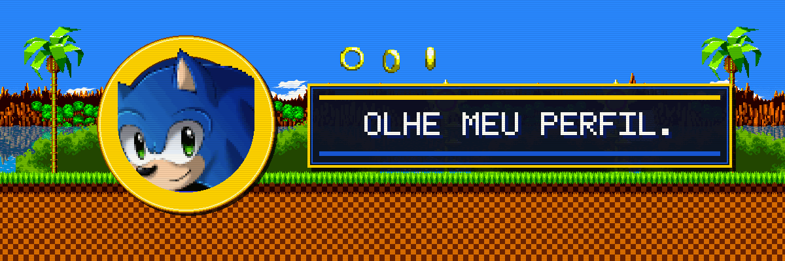

 

<!-- ===================================================================== -->
<!-- 02. IDENTITY — EVANDRO (@LLEWXAMDEV)                                  -->
<!-- ===================================================================== -->
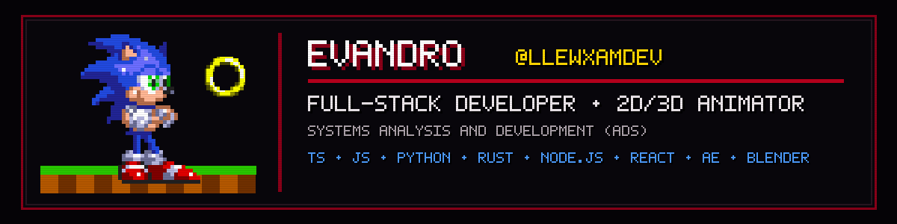

 

<!-- ===================================================================== -->
<!-- 03. PROJECTS — REAL REPOSITORIES & INTERACTIVE PORTFOLIO              -->
<!-- ===================================================================== -->
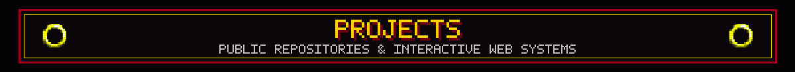

<table align="center" width="100%">
  <tr>
    <td align="center" width="50%">
      <a href="https://www.llewxam.me">
        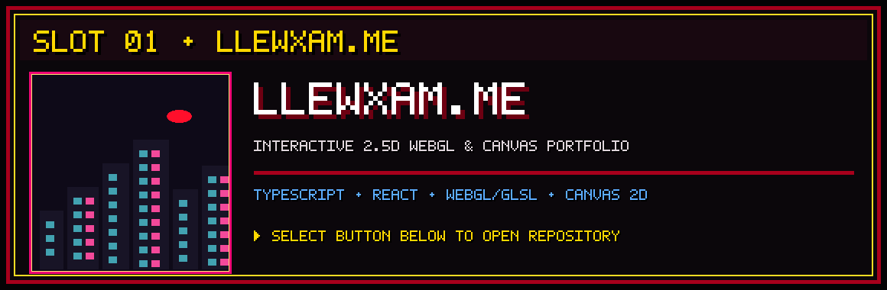
      </a>
       
      <a href="https://www.llewxam.me">
        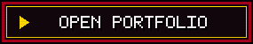
      </a>
    </td>
    <td align="center" width="50%">
      <a href="https://github.com/LlewxamDev/AegisHub">
        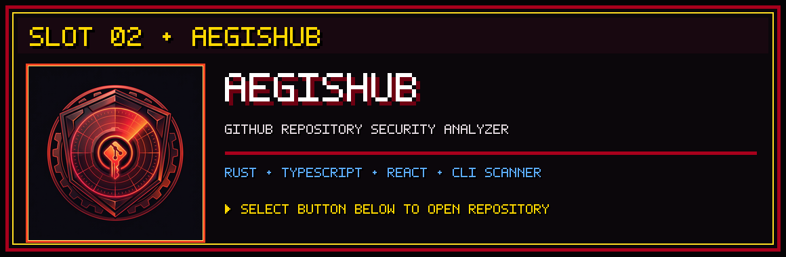
      </a>
       
      <a href="https://github.com/LlewxamDev/AegisHub">
        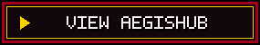
      </a>
    </td>
  </tr>
  <tr>
    <td align="center" width="50%">
      <a href="https://github.com/LlewxamDev/AegisCore">
        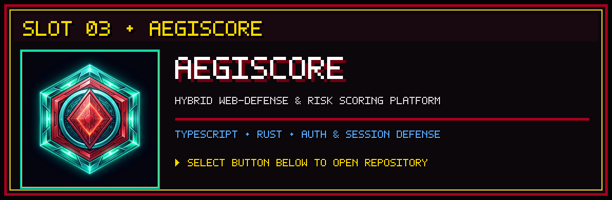
      </a>
       
      <a href="https://github.com/LlewxamDev/AegisCore">
        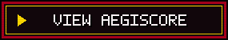
      </a>
    </td>
    <td align="center" width="50%">
      <a href="https://github.com/LlewxamDev/HackerPage">
        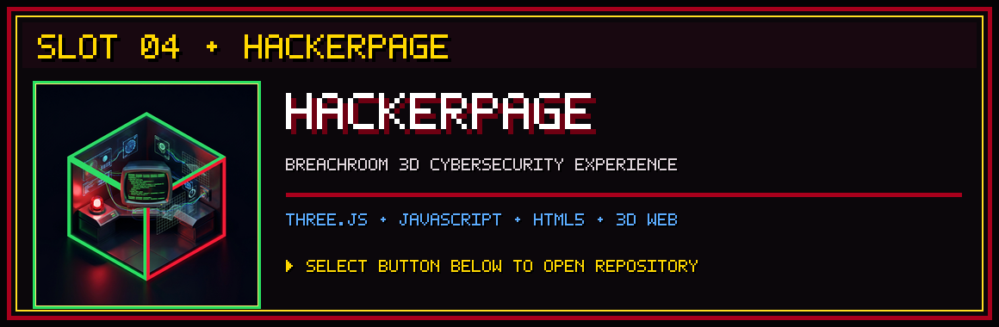
      </a>
       
      <a href="https://github.com/LlewxamDev/HackerPage">
        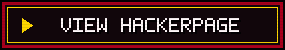
      </a>
    </td>
  </tr>
  <tr>
    <td align="center" width="50%">
      <a href="https://github.com/LlewxamDev/Soul-List">
        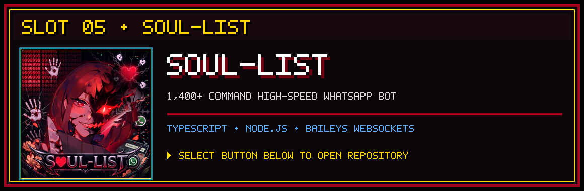
      </a>
       
      <a href="https://github.com/LlewxamDev/Soul-List">
        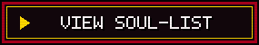
      </a>
    </td>
    <td align="center" width="50%">
      <a href="https://github.com/LlewxamDev/Polybech">
        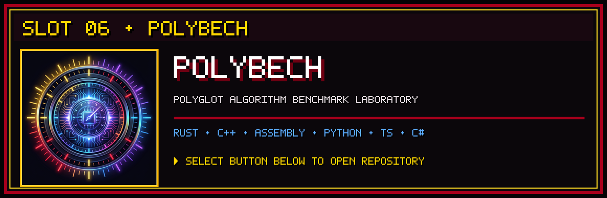
      </a>
       
      <a href="https://github.com/LlewxamDev/Polybech">
        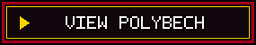
      </a>
    </td>
  </tr>
</table>

 

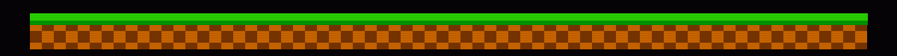

<!-- ===================================================================== -->
<!-- 04. TECHNOLOGIES — CORRUPTED GREEN HILL ZONE                          -->
<!-- ===================================================================== -->
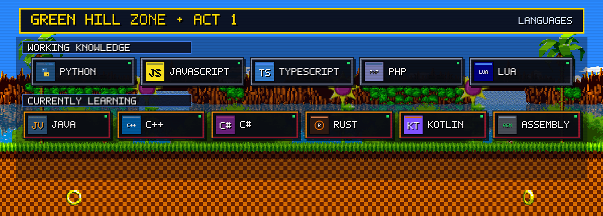

  

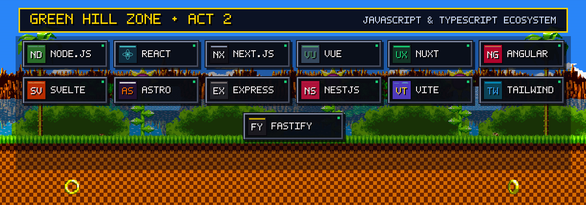

  

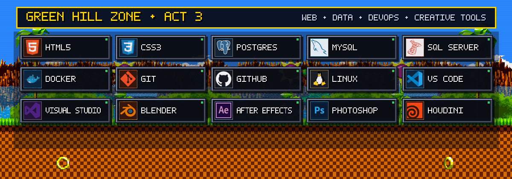

 

<!-- ===================================================================== -->
<!-- 05. TROPHY SELECTION & LIVE GITHUB METRICS                            -->
<!-- ===================================================================== -->
<!-- Vercel Serverless Endpoint: https://<your-vercel-domain>.vercel.app/api/trophies?username=LlewxamDev -->
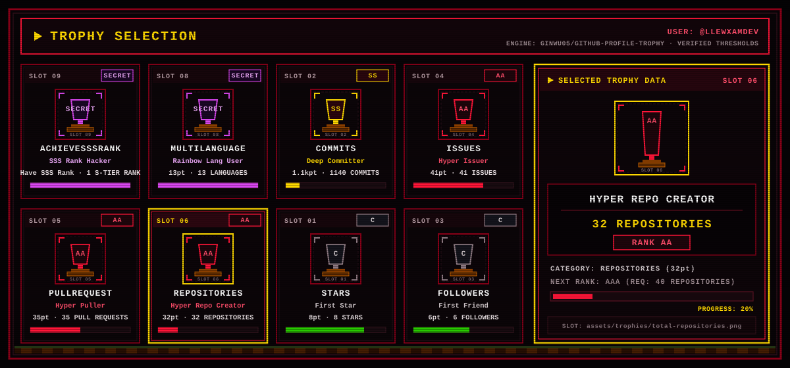

  

<table align="center" width="100%">
  <tr>
    <td align="center" width="50%">
      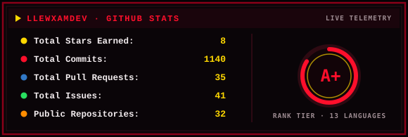
    </td>
    <td align="center" width="50%">
      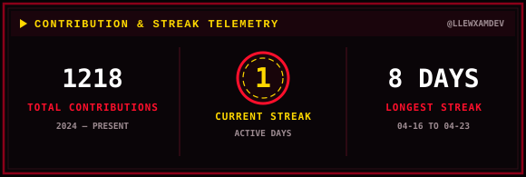
    </td>
  </tr>
</table>

 

<!-- ===================================================================== -->
<!-- 06. FOOTER — SONIC.EXE MENU NAVIGATION                                -->
<!-- ===================================================================== -->
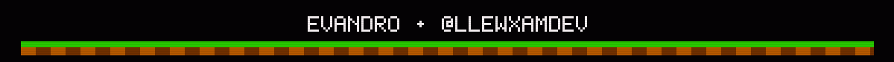

  <a href="https://github.com/LlewxamDev">
    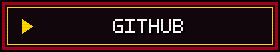
  </a>
  &nbsp;&nbsp;
  <a href="https://www.llewxam.me">
    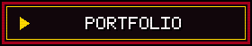
  </a>
  &nbsp;&nbsp;
  <a href="https://www.linkedin.com/in/evandro-silva-amorimm">
    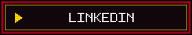
  </a>

