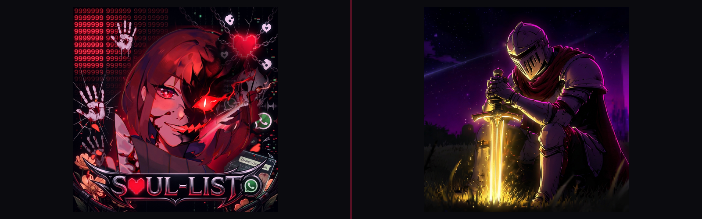

  

  
  &nbsp;
  
  &nbsp;
  
  &nbsp;
  

---

## `01` — Sobre mim

Estudante de **Análise e Desenvolvimento de Sistemas (ADS)** e desenvolvedor Full-Stack focado em arquiteturas assíncronas, APIs de alta performance, segurança de aplicações e automação de sistemas. Gosto de projetar soluções completas — desde plataformas de defesa web e analisadores estáticos em **TypeScript** e **Rust** até ecossistemas de bots de alta vazão e interfaces interativas em **React** e **WebGL**. Abordo problemas com mentalidade de engenharia: código limpo, tipagem estrita, baixa latência e decisões técnicas orientadas a produção.

---

## `02` — Tecnologias

Seleção das linguagens, frameworks e ferramentas mais utilizados nos meus projetos e sistemas em produção:

### Linguagens principais

     

### Back-end, APIs & dados

     

### Front-end & gráficos

     

### Ferramentas & ambiente

     

---

## `03` — Projetos em destaque

### 1. AegisCore — Plataforma Híbrida de Defesa Web & Risk Scoring

<table>
  <tr>
    <td width="52%" valign="top">
      
    </td>
    <td width="48%" valign="top">
      
<strong>Problema:</strong> APIs modernas sofrem com ataques de injeção, abuso de sessão e bursts de requisições onde middlewares puramente em JS introduzem gargalos de latência.

      
<strong>Solução:</strong> Plataforma modular de defesa web que combina um gateway HTTP em <strong>Fastify</strong> com crates nativos em <strong>Rust</strong> para inspeção de payloads e cálculo de risco em sub-milissegundos.

      
<strong>Demonstração:</strong> Execução do repositório mostrando o gateway Fastify, a inspeção de payloads e o painel administrativo em funcionamento.

      
<code>TypeScript</code> · <code>Fastify</code> · <code>Rust</code> · <code>Prisma</code> · <code>Redis</code> · <code>React</code>

      

        <a href="https://github.com/LlewxamDev/AegisCore"><strong>Repositório ↗</strong></a>
      

    </td>
  </tr>
</table>

 

### 2. AegisHub — Analisador Estático de Segurança para Repositórios GitHub

<table>
  <tr>
    <td width="52%" valign="top">
      
    </td>
    <td width="48%" valign="top">
      
<strong>Problema:</strong> Vazamento de credenciais, permissões excessivas em pipelines CI/CD e dependências vulneráveis costumam passar despercebidos antes do merge.

      
<strong>Solução:</strong> Suite de auditoria automatizada com motor de varredura em <strong>Rust</strong>, CLI dedicada, fila de orquestração em <strong>Fastify + BullMQ</strong> e dashboard analítico em <strong>React</strong>.

      
<strong>Demonstração:</strong> Execução do repositório mostrando o scanner, a fila de análise e o dashboard de pontuação de segurança.

      
<code>Rust</code> · <code>TypeScript</code> · <code>Fastify</code> · <code>BullMQ</code> · <code>Prisma</code> · <code>React</code>

      

        <a href="https://github.com/LlewxamDev/AegisHub"><strong>Repositório ↗</strong></a>
      

    </td>
  </tr>
</table>

 

### 3. Soul-List & LWX Lab — Ecossistema de Bots & Automação em Tempo Real

<table>
  <tr>
    <td width="52%" valign="top">
      
    </td>
    <td width="48%" valign="top">
      
<strong>Problema:</strong> Servidores comerciais e grupos de alta concorrência exigem automação de atendimento, triagem de pedidos e execução instantânea de comandos sem bloqueio de Event Loop.

      
<strong>Solução:</strong> <strong>Soul-List</strong> (motor WhatsApp via WebSockets diretos com mais de 1.400 comandos indexados em <code>O(1)</code>) e <strong>LWX Lab</strong> (automação comercial completa no Discord com tickets, orçamentos, fila de produção e integração com IA).

      
<strong>Demonstração:</strong> O material visual usa somente as logos dos dois projetos; não representa uma nova implementação nem atribui a criação dos repositórios.

      
<code>TypeScript</code> · <code>Node.js</code> · <code>Drizzle ORM</code> · <code>Zod</code>

      

        <a href="https://github.com/LlewxamDev/Soul-List"><strong>Repositório (Soul-List) ↗</strong></a> &nbsp;·&nbsp;
        <a href="https://www.llewxam.me"><strong>Demonstração no Portfólio ↗</strong></a>
      

    </td>
  </tr>
</table>

 

### 4. HyperFlow 3D & Polybech — Computação Gráfica (Blender 5.2+) & Benchmarks Poliglotas

<table>
  <tr>
    <td width="52%" valign="top">
      
    </td>
    <td width="48%" valign="top">
      
<strong>Problema:</strong> Retopologia manual, ruído temporal em renderização path-tracing e comparação empírica de algoritmos entre linguagens de baixo e alto nível exigem ferramentas precisas.

      
<strong>Solução:</strong> <strong>HyperFlow 3D</strong> entrega retopologia quad guiada por curvatura, baking PBR em 1 clique e denoiser temporal com patches C++ para o Blender 5.2+; <strong>Polybech</strong> executa benchmarks comparativos entre 7 linguagens.

      
<strong>Formato da demonstração:</strong> Execução do HyperFlow diretamente no Blender; no Polybech, somente a etapa de benchmark e seus resultados finais.

      
<code>Python</code> · <code>C++</code> · <code>Rust</code> · <code>Assembly x86-64</code> · <code>TypeScript</code>

      

        <a href="https://github.com/LlewxamDev/blender-hyperflow"><strong>Repositório (HyperFlow 3D) ↗</strong></a> &nbsp;·&nbsp;
        <a href="https://github.com/LlewxamDev/Polybech"><strong>Repositório (Polybech) ↗</strong></a>
      

    </td>
  </tr>
</table>

 

### 5. LLEWXAM.ME — Portfólio Interativo 2.5D em WebGL & Shaders GLSL

<table>
  <tr>
    <td width="52%" valign="top">
      
    </td>
    <td width="48%" valign="top">
      
<strong>Problema:</strong> Portfólios tradicionais costumam ser páginas estáticas padronizadas que não demonstram domínio real de engenharia front-end, programação gráfica ou arquitetura de estado.

      
<strong>Solução:</strong> Experiência web autoral construída com pipeline híbrido <strong>WebGL (GLSL Vertex & Fragment Shaders) + Canvas 2D + React 18/TypeScript</strong>, com parallax multi-plano por mapa de profundidade e player físico de flipbook sincronizado a vídeo.

      
<strong>Formato da demonstração:</strong> Personagem totalmente visível desde o início, movimento lateral do mouse para evidenciar o parallax e o cursor personalizado, finalizando após a abertura da janela de navegação.

      
<code>TypeScript</code> · <code>React</code> · <code>WebGL / GLSL</code> · <code>Canvas 2D</code> · <code>Vite</code>

      

        <a href="https://www.llewxam.me"><strong>Demonstração Ao Vivo (llewxam.me) ↗</strong></a> &nbsp;·&nbsp;
        <a href="https://github.com/LlewxamDev/HackerPage"><strong>Ver também: HackerPage 3D ↗</strong></a>
      

    </td>
  </tr>
</table>

---

## `04` — Em constante evolução

- **Atualmente aprendendo:**
  
  
  
  
  
  

- **Arquitetura Back-end & Sistemas Escaláveis:** Aprofundando padrões de arquitetura modular, injeção de dependência, filas distribuídas e microsserviços com **NestJS**, **Fastify**, **Redis/BullMQ** e bancos relacionais.
- **Engenharia Híbrida de Alta Performance:** Expandindo a integração entre **TypeScript/Node.js** e motores nativos em **Rust** e **C++** para segurança ofensiva/defensiva, parsers de baixa latência e ferramentas de linha de comando.
- **Automação Inteligente & Computação Visual:** Explorando agentes autônomos, workflows comerciais em tempo real e pipelines gráficos acelerados por GPU (**WebGL / GLSL** e automação técnica em **Python**).

 

  

