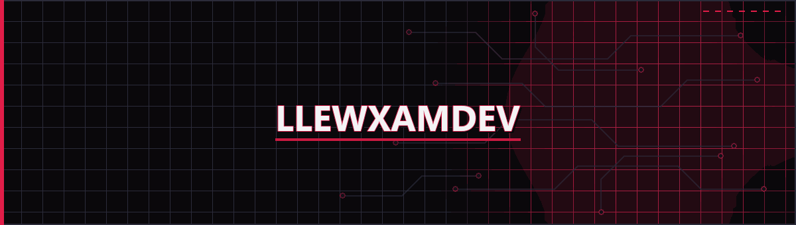
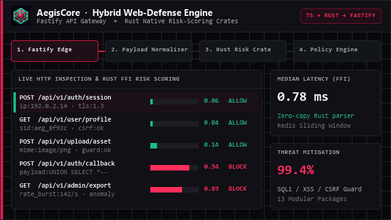
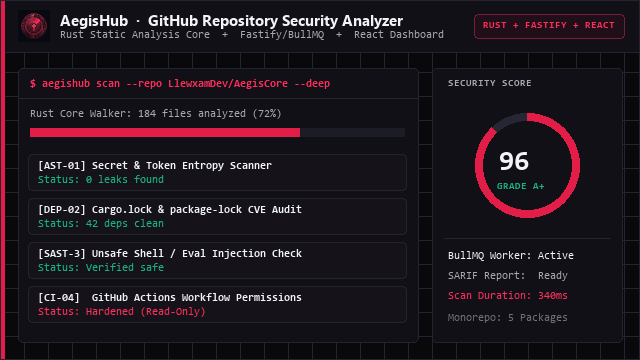
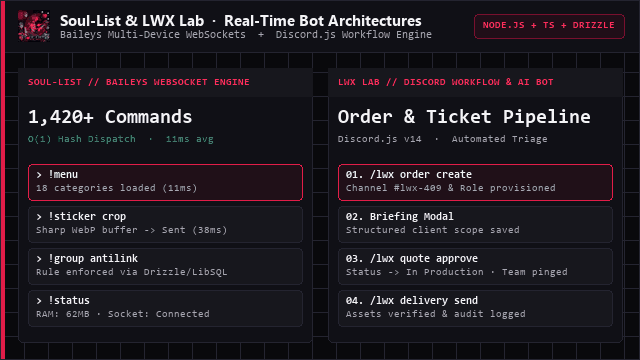
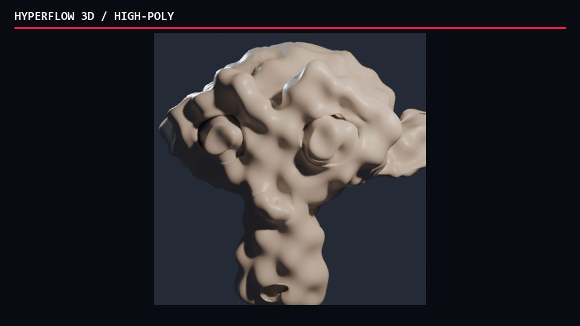

  

  
  &nbsp;
  
  &nbsp;
  
  &nbsp;
  

---

## `01` — Sobre mim

Estudante de **Análise e Desenvolvimento de Sistemas (ADS)** e desenvolvedor Full-Stack focado em arquiteturas assíncronas, APIs de alta performance, segurança de aplicações e automação de sistemas. Gosto de projetar soluções completas — desde plataformas de defesa web e analisadores estáticos em **TypeScript** e **Rust** até ecossistemas de bots de alta vazão e interfaces interativas em **React** e **WebGL**. Abordo problemas com mentalidade de engenharia: código limpo, tipagem estrita, baixa latência e decisões técnicas orientadas a produção.

---

## `02` — Tecnologias

Seleção das linguagens, frameworks e ferramentas mais utilizados nos meus projetos e sistemas em produção:

  

 

| Domínio | Tecnologias Mais Utilizadas |
| :--- | :--- |
| **Linguagens Principais** | `TypeScript` · `JavaScript` · `Python` · `Rust` · `C++` · `SQL` |
| **Back-end & APIs** | `Node.js` · `NestJS` · `Fastify` · `Express` · `Prisma` · `Drizzle ORM` |
| **Front-end & Gráficos** | `React` · `Next.js` · `Vite` · `Tailwind CSS` · `Three.js / WebGL` · `HTML5 & CSS3` |
| **Automação & Ambiente** | `Discord.js` · `Baileys (WebSockets)` · `PostgreSQL` · `Redis / BullMQ` · `Docker` · `Git & GitHub` · `Linux / Bash` · `PowerShell` |

---

## `03` — Projetos em destaque

### 1. AegisCore — Plataforma Híbrida de Defesa Web & Risk Scoring

<table>
  <tr>
    <td width="52%" valign="top">
      
    </td>
    <td width="48%" valign="top">
      
<strong>Problema:</strong> APIs modernas sofrem com ataques de injeção, abuso de sessão e bursts de requisições onde middlewares puramente em JS introduzem gargalos de latência.

      
<strong>Solução:</strong> Plataforma modular de defesa web que combina um gateway HTTP em <strong>Fastify</strong> com crates nativos em <strong>Rust</strong> para inspeção de payloads e cálculo de risco em sub-milissegundos.

      
<strong>Minha contribuição:</strong> Arquitetei o monorepo com 13 pacotes TypeScript (auth, sessão, CSRF, rate-limit, policy-engine, observabilidade), 4 crates Rust para normalização e scoring de risco, e o painel administrativo em React 19.

      
<code>TypeScript</code> · <code>Fastify</code> · <code>Rust</code> · <code>Prisma</code> · <code>Redis</code> · <code>React</code>

      

        <a href="https://github.com/LlewxamDev/AegisCore"><strong>Repositório ↗</strong></a>
      

    </td>
  </tr>
</table>

 

### 2. AegisHub — Analisador Estático de Segurança para Repositórios GitHub

<table>
  <tr>
    <td width="52%" valign="top">
      
    </td>
    <td width="48%" valign="top">
      
<strong>Problema:</strong> Vazamento de credenciais, permissões excessivas em pipelines CI/CD e dependências vulneráveis costumam passar despercebidos antes do merge.

      
<strong>Solução:</strong> Suite de auditoria automatizada com motor de varredura em <strong>Rust</strong>, CLI dedicada, fila de orquestração em <strong>Fastify + BullMQ</strong> e dashboard analítico em <strong>React</strong>.

      
<strong>Minha contribuição:</strong> Desenvolvi o scanner de entropia e análise estática em Rust, a API orquestradora com filas Redis/BullMQ, a integração GitHub App via Octokit e o dashboard visual de pontuação de segurança.

      
<code>Rust</code> · <code>TypeScript</code> · <code>Fastify</code> · <code>BullMQ</code> · <code>Prisma</code> · <code>React</code>

      

        <a href="https://github.com/LlewxamDev/AegisHub"><strong>Repositório ↗</strong></a>
      

    </td>
  </tr>
</table>

 

### 3. Soul-List & LWX Lab — Ecossistema de Bots & Automação em Tempo Real

<table>
  <tr>
    <td width="52%" valign="top">
      
    </td>
    <td width="48%" valign="top">
      
<strong>Problema:</strong> Servidores comerciais e grupos de alta concorrência exigem automação de atendimento, triagem de pedidos e execução instantânea de comandos sem bloqueio de Event Loop.

      
<strong>Solução:</strong> <strong>Soul-List</strong> (motor WhatsApp via WebSockets diretos com mais de 1.400 comandos indexados em <code>O(1)</code>) e <strong>LWX Lab</strong> (automação comercial completa no Discord com tickets, orçamentos, fila de produção e integração com IA).

      
<strong>Minha contribuição:</strong> Implementei o roteador de comandos de baixa latência, processamento nativo de mídia em buffer com Sharp/FFmpeg, persistência com Drizzle ORM e fluxos interativos em Discord.js v14.

      
<code>TypeScript</code> · <code>Node.js</code> · <code>Baileys</code> · <code>Discord.js</code> · <code>Drizzle ORM</code> · <code>Zod</code>

      

        <a href="https://github.com/LlewxamDev/Soul-List"><strong>Repositório (Soul-List) ↗</strong></a> &nbsp;·&nbsp;
        <a href="https://www.llewxam.me"><strong>Demonstração no Portfólio ↗</strong></a>
      

    </td>
  </tr>
</table>

 

### 4. HyperFlow 3D & Polybech — Computação Gráfica (Blender 5.2+) & Benchmarks Poliglotas

<table>
  <tr>
    <td width="52%" valign="top">
      
    </td>
    <td width="48%" valign="top">
      
<strong>Problema:</strong> Retopologia manual, ruído temporal em renderização path-tracing e comparação empírica de algoritmos entre linguagens de baixo e alto nível exigem ferramentas precisas.

      
<strong>Solução:</strong> <strong>HyperFlow 3D</strong> entrega retopologia quad guiada por curvatura, baking PBR em 1 clique e denoiser temporal com patches C++ para o Blender 5.2+; <strong>Polybech</strong> executa benchmarks comparativos entre 7 linguagens.

      
<strong>Minha contribuição:</strong> Escrevi os 4 módulos em Python e 3 patches de núcleo em C++ para o Blender no HyperFlow 3D, além da bateria automatizada de comparação algorítmica no Polybech.

      
<code>Python</code> · <code>C++</code> · <code>Rust</code> · <code>Assembly x86-64</code> · <code>TypeScript</code>

      

        <a href="https://github.com/LlewxamDev/blender-hyperflow"><strong>Repositório (HyperFlow 3D) ↗</strong></a> &nbsp;·&nbsp;
        <a href="https://github.com/LlewxamDev/Polybech"><strong>Repositório (Polybech) ↗</strong></a>
      

    </td>
  </tr>
</table>

 

### 5. LLEWXAM.ME — Portfólio Interativo 2.5D em WebGL & Shaders GLSL

<table>
  <tr>
    <td width="52%" valign="top">
      
    </td>
    <td width="48%" valign="top">
      
<strong>Problema:</strong> Portfólios tradicionais costumam ser páginas estáticas padronizadas que não demonstram domínio real de engenharia front-end, programação gráfica ou arquitetura de estado.

      
<strong>Solução:</strong> Experiência web autoral construída com pipeline híbrido <strong>WebGL (GLSL Vertex & Fragment Shaders) + Canvas 2D + React 18/TypeScript</strong>, com parallax multi-plano por mapa de profundidade e player físico de flipbook sincronizado a vídeo.

      
<strong>Minha contribuição:</strong> Desenvolvi os shaders GLSL customizados (refração FBM, emissão seletiva e câmera 2.5D), a máquina de estados determinística de 12 estágios e o motor de física de tinta em Canvas 2D.

      
<code>TypeScript</code> · <code>React</code> · <code>WebGL / GLSL</code> · <code>Canvas 2D</code> · <code>Vite</code>

      

        <a href="https://www.llewxam.me"><strong>Demonstração Ao Vivo (llewxam.me) ↗</strong></a> &nbsp;·&nbsp;
        <a href="https://github.com/LlewxamDev/HackerPage"><strong>Ver também: HackerPage 3D ↗</strong></a>
      

    </td>
  </tr>
</table>

---

## `04` — Em constante evolução

- **Arquitetura Back-end & Sistemas Escaláveis:** Aprofundando padrões de arquitetura modular, injeção de dependência, filas distribuídas e microsserviços com **NestJS**, **Fastify**, **Redis/BullMQ** e bancos relacionais.
- **Engenharia Híbrida de Alta Performance:** Expandindo a integração entre **TypeScript/Node.js** e motores nativos em **Rust** e **C++** para segurança ofensiva/defensiva, parsers de baixa latência e ferramentas de linha de comando.
- **Automação Inteligente & Computação Visual:** Explorando agentes autônomos, workflows comerciais em tempo real e pipelines gráficos acelerados por GPU (**WebGL / GLSL** e automação técnica em **Python**).

 

  

